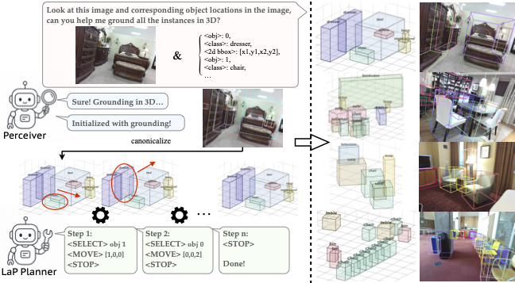
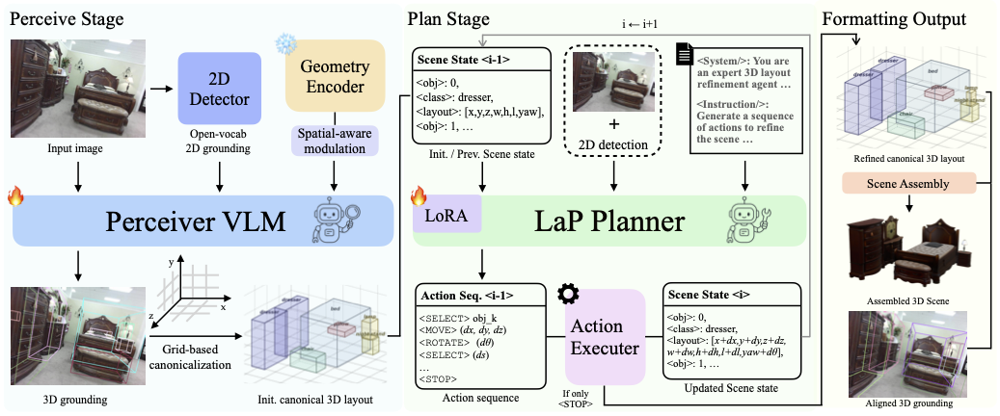

<div align="center">
<h2>Perceive-then-Plan: Layout-as-Policy for Monocular 3D Scene Layout Estimation</h2>
<p><b>NeurIPS 2026</b></p>
<p>
<a href="https://colezwhy.github.io/" target="_blank">Junwei Zhou</a>,
<a href="https://yuwingtai.github.io/" target="_blank">Yu-Wing Tai</a>
</p>
<p>Dartmouth College</p>
</div>

>**TL;DR**: <em> We propose a perceive-then-plan framework with two VLMs (Perceiver and LaP Planner) for monocular 3D layout estimation, enabling both visual alignment and physical plausibility.</em>

<p align="center">
  <a href="https://neurips.cc/">
    
  </a>
  <a href="https://colezwhy.github.io/perceivethenplan/">
    
  </a>
<a href="https://arxiv.org/abs/2605.25326">
  
</a>
  <a href="https://huggingface.co/Colezwhy/Perceive-then-Plan">
    
  </a>
    <a href="#">
    
  </a>
</p>

<div align="center">

</div>

Official implementation for paper 'Perceive-then-Plan: Layout-as-Policy for Monocular 3D Scene Layout Estimation'.

In this work, we formulate monocular 3D layout estimation as a perceive-then-plan problem with vision-language models, where a Perceiver first grounds the 3D objects and then a Planner iteratively refines the scene hypothesis through actions that improve physical plausibility while preserving consistency with the input image.

## 📢 Updates and TODOs
- 🎉 Perceive-then-Plan is accepted to **NeurIPS 2026**!
- ✅ 06/15/2026: Initialize the project page.
- ✅ 10/23/2026: Release Stage 1 (Perceiver) code: data preparation, training, inference and evaluation.
- ✅ 10/23/2026: Release the Perceiver 2B checkpoint on [🤗 Hugging Face](https://huggingface.co/Colezwhy/Perceive-then-Plan).
- ⏳ Release Stage 2 (LaP Planner) code.

## 🧭 Method
<p align="center">
  
</p>

<p align="center">
The Perceiver grounds 3D boxes from the input image. A canonicalized, grid-based representation is then iteratively refined by the LaP Planner, which treats each layout as a structured state and selects discrete actions (translate, rotate, rescale) via a learned policy until convergence. The final layout supports both scene assembly (digital twin) and camera-space projection (3D grounding).
</p>

## 🛠️ Installation
```bash
conda create -n ptp python=3.10 -y
conda activate ptp
# install PyTorch >= 2.6 for your CUDA version (https://pytorch.org), then
pip install -r perceiver/requirements.txt
pip install flash-attn --no-build-isolation   # optional
```

## 🚀 Stage 1: Perceiver
Download the Omni3D annotations and the SUN RGB-D / Hypersim images following the [Omni3D data guide](https://github.com/facebookresearch/omni3d/blob/main/DATA.md). `$OMNI3D` is the folder that contains `datasets/`. All commands are run from `perceiver/`.

### 📦 Data
```bash
python tools/prepare_omni3d.py --mode train --omni3d-json-dir $OMNI3D/datasets/Omni3D \
    --output data/omni3d/train.json
python tools/prepare_omni3d.py --mode eval --omni3d-json-dir $OMNI3D/datasets/Omni3D \
    --output data/omni3d/eval.json --gt-output data/omni3d/eval_gt.json
```
Use `--min-objects` / `--max-objects` to keep only images with that many objects.

### 🏋️ Training (4 GPUs)
```bash
TRAIN_JSON=data/omni3d/train.json IMAGE_ROOT=$OMNI3D/datasets \
MODEL=Qwen/Qwen3-VL-2B-Instruct bash scripts/train_perceiver.sh
```
Options: `MODEL=Qwen/Qwen3-VL-8B-Instruct`, `NPROC_PER_NODE`, `OUTPUT_DIR`, `ATTN=sdpa` (without flash-attn), `REPORT_TO=wandb`.

### 🔍 Inference
```bash
python tools/infer.py --eval-json data/omni3d/eval.json --image-root $OMNI3D/datasets \
    --output results/predictions.json --limit 1000
```
This loads the released Perceiver 2B from [🤗 Colezwhy/Perceive-then-Plan](https://huggingface.co/Colezwhy/Perceive-then-Plan) (`perceiver-2b/`). Add `--model output/perceiver-Qwen3-VL-2B-Instruct` to use your own checkpoint.

### 📊 Evaluation
```bash
python tools/evaluate.py --predictions results/predictions.json --gt data/omni3d/eval_gt.json
```

### 🧱 Grid layouts for Stage 2
```bash
python tools/canonicalize.py --predictions results/predictions.json \
    --eval-json data/omni3d/eval.json --output results/grid_layouts.json
```

## 📝 Citation
Here is the bibtex reference. If you find our work interesting or useful, please give us a :star: or cite our paper!
```
@inproceedings{zhou2026perceivethenplan,
  title={Perceive-then-Plan: Layout-as-Policy for Monocular 3D Scene Layout Estimation},
  author={Zhou, Junwei and Tai, Yu-Wing},
  booktitle={Advances in Neural Information Processing Systems},
  year={2026}
}
```

## 🙏 Acknowledgements
This code builds on these great projects. Many thanks to their authors!

- 🤖 [Qwen3-VL](https://github.com/QwenLM/Qwen3-VL): base VLM and fine-tuning code
- 🧩 [VG-LLM](https://github.com/LaVi-Lab/VG-LLM): geometry encoder and feature fusion
- 📐 [VGGT](https://github.com/facebookresearch/vggt): geometry features (`perceiver/ptp_perceiver/third_party/vggt`, VGGT License)
- 🏠 [Omni3D](https://github.com/facebookresearch/omni3d): Hypersim and SUN RGB-D annotations
